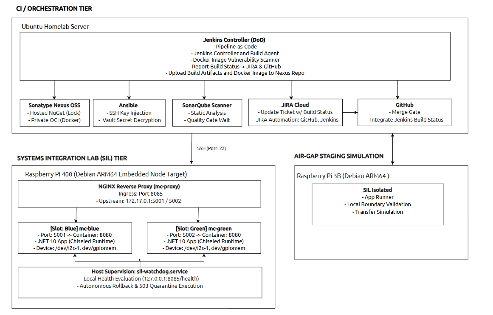

# **MissionControl: Defence-Grade CI/CD & SIL Deployment Pipeline for C#/.NET 10**

An enterprise-grade, auditable CI/CD delivery pipeline and deployment framework designed for mission-critical C#/.NET naval and sensor systems. Built to meet the operational demands of defence Systems Integration Laboratories (SIL) and tactical edge environments, this repository demonstrates reproducible builds, air-gapped artifact governance, container runtime hardening, Hardware-in-the-Loop pre-flight verification, and autonomous fault recovery.

## **1. Executive Summary & Architecture Highlights**

* **Reproducible .NET 10 Compilation:** Solution-wide deterministic compilation (/p:Deterministic=true), compiler warning zero-tolerance (/p:TreatWarningsAsErrors=true), and strict SHA-512 dependency locking via packages.lock.json with *dotnet restore --locked-mode*.  
* **Air-Gapped Supply Chain Governance:** Self-hosted Sonatype Nexus OSS hosting private OCI Docker registries and local NuGet feeds with Package Source Mapping enabled. Zero runtime internet dependencies.  
* **Hardened Distroless Packaging:** Multi-stage Docker builds targeting **Ubuntu Chiseled** ([mcr.microsoft.com/dotnet/aspnet:10.0-noble-chiseled](https://mcr.microsoft.com/en-us/artifact/mar/dotnet/aspnet/tag/10.0-noble-chiseled)), running as an unprivileged UID ($APP_UID), devoid of shells, package managers, and root access.  
* **Automated Static & Dynamic Security Gates:** Jenkins pipeline gating on SonarQube quality gates (sonar.qualitygate.wait=true) and Trivy vulnerability assessments (--exit-code 1 on HIGH/CRITICAL CVEs).  
* **Hardware-in-the-Loop (HIL) Pre-Flight Gating:** Ansible pre-flight checks validating host environmental boundaries (thermal throttling, memory/disk pressure) and kernel-level character bus bindings (/dev/i2c-1, /dev/gpiomem) before cutover.  
* **Blue/Green Zero-Downtime Deployment:** Atomic ingress routing over custom unprivileged sockets (port 8085) using NGINX upstream reconfiguration and dynamic Docker IPAM discovery.  
* **Defense-in-Depth Automated Rollback Ladder:**  
  1. *Pipeline-Level Automated Rollback:* Reverts to the standby slot if health checks or integration smoke tests fail.  
  2. *Double-Fault Critical Stop Protocol:* Quarantines the node into an HTTP 503 Maintenance Mode with Retry-After: 300 headers and dumps kernel/process forensics if both execution slots fail.  
  3. *Autonomous Host Supervisor (sil-watchdog.service):* Host-level systemd daemon executing out-of-band rollback if central CI connectivity drops.  
* **End-to-End Audit Traceability:** Bidirectional commit-to-issue tracking updating Jira issues via authenticated REST APIs on build, verification, rollback, or quarantine events.

## **2. System Architecture**


                                  
  

## **3. Hardware-in-the-Loop (HIL) Testbed Topology**

| Node Identifier | Hardware & OS | Operational Role | Key Software Components |
| :---- | :---- | :---- | :---- |
| **homelab-dev** | Lenovo ThinkPad (WSL2 Ubuntu 24.04) | Workstation & Out-of-Band Admin | Git, VS Code, Ansible Core, SSH |
| **homelab-node1** | Mini PC (AMD Ryzen 7, 32GB RAM, Ubuntu) | CI Controller & Registry Store | Jenkins (DooD), Sonatype Nexus OSS, Docker Engine |
| **sil-agent-01** | Raspberry Pi 400 (4GB RAM, Broadcom ARM64) | SIL Edge Integration Target | Docker Engine, NGINX 1.27, Broadcom I2C bus |
| **sil-isolated** | Raspberry Pi 3B (1GB RAM, Debian) | Air-Gap Staging Simulation | Local boundary validation, transfer simulation |

## **4. Tech Stack & Tooling Architecture**

The delivery toolchain and testbed are engineered to satisfy Canadian Controlled Goods Program (CGP) parameters, air-gapped staging rules, and IEEE 828 configuration baselines. Every tier maps directly to mission-critical naval and sensor integration requirements:

| Architectural Tier | Technology / Tooling | Version / Specification | Defence & SIL Role / Justification |
| :--- | :--- | :--- | :--- |
| **Language & SDK Runtime** | **C# / .NET SDK** | `net10.0` / `net8.0` (LTS) | Mission gateway microservices, ASP.NET Core Kestrel web host, P/Invoke native interop bindings. |
| **Build Engine & Compilation** | **MSBuild & .NET CLI** | Integrated SDK 10 / 8 | Deterministic compilation (`/p:Deterministic=true`), zero-compiler-warning policy (`/p:TreatWarningsAsErrors=true`), SourceLink Git metadata. |
| **Dependency Governance** | **NuGet Package Manager** | `packages.lock.json` + `nuget.config` | Strict SHA-512 dependency hashing via `--locked-mode`; air-gapped `<packageSourceMapping>` strictly preventing public registry lookups. |
| **Container Runtime & Base** | **Docker Engine & Buildx** | MCR Ubuntu Jammy/Noble Chiseled | Distroless, hardened non-root container images (`$APP_UID`), devoid of shells, package managers, and standard attack vectors. |
| **Pipeline-as-Code (CI/CD)** | **Jenkins (DooD)** | 2.541+ LTS (Declarative `Jenkinsfile`) | 7-stage multibranch pipeline: locked build, SAST, CVE scan, OCI push, Ansible deployment, automated smoke test, and rollback triggers. |
| **Artifact & Registry Hub** | **Sonatype Nexus OSS** | 3.7x (Private Hosted/Group) | Private authenticated OCI Docker v2 registry (`:8082`), internal NuGet feed (`:8081`), and raw binary tarball storage. |
| **Static Code Analysis (SAST)** | **SonarQube Community** | 10.x Server / Scanner 9.0.1 | Quality gate enforcement (`sonar.qualitygate.wait=true`), Roslyn code analysis rules, and automated test coverage reporting. |
| **Container CVE & Secret Scan** | **Aquasec Trivy** | v0.58+ | Automated vulnerability gate scanning candidate images for `HIGH` and `CRITICAL` CVEs before registry ingress. |
| **Deployment Orchestration** | **Ansible Core** | 2.16+ (`community.docker`, `ansible.posix`) | Idempotent SIL cutover, Hardware-in-the-Loop pre-flight assertions, dynamic Docker IPAM gateway discovery, zero-downtime execution[cite: 7, 8]. |
| **Secrets Management** | **Ansible Vault** | AES-256 (`vault.yml`) | Encryption-at-rest for registry tokens and private deployment keys; transient memory decryption eliminating process-table exposure (`ps aux`)[cite: 7, 8]. |
| **Edge Ingress & Reverse Proxy**| **NGINX Reverse Proxy** | 1.27 Alpine | Atomic upstream proxy cutover on unprivileged port `8085`, graceful worker reload (`nginx -s reload`), and 503 maintenance mode quarantine[cite: 7, 8]. |
| **Embedded Supervisor / Watchdog**| **Systemd & Bash** | `sil-watchdog.service` | Out-of-band host supervisor daemon monitoring port 8085, executing autonomous rollback and double-fault quarantine when CI is unreachable[cite: 7, 8]. |
| **Hardware Bus (HIL)** | **Linux Kernel Device Tree** | Broadcom I2C (`/dev/i2c-1`), `/dev/gpiomem` | Hardware-in-the-Loop character device node validation and non-root POSIX container passthrough for sensor subsystems[cite: 7, 8]. |
| **Audit & Issue Traceability** | **Atlassian Jira REST API** | v2 REST API (Issue `DRS-12`) | Automated bidirectional telemetry logging commit SHAs, test results, build outcomes, and forensic quarantine dumps to release tickets[cite: 7, 8]. |

## **5. DevSecOps & Supply Chain Governance**

### **Solution-Wide Deterministic Configuration (Directory.Build.props)**

```xml
<Project>  
  <PropertyGroup>  
    <Nullable>enable</Nullable>  
    <ImplicitUsings>enable</ImplicitUsings>  
    <TreatWarningsAsErrors>true</TreatWarningsAsErrors>  
    <Deterministic>true</Deterministic>  
    <RestoreLockedMode>true</RestoreLockedMode>  
    <ContinuousIntegrationBuild>true</ContinuousIntegrationBuild>  
  </PropertyGroup>  
</Project>
```

### **Air-Gapped Package Source Mapping (nuget.config)**

```xml  
<?xml version="1.0" encoding="utf-8"?>  
<configuration>  
  <packageSources>  
    <clear />  
    <add key="nexus-hosted-nuget" value="http://10.0.0.182:8081/repository/nuget-hosted/index.json" />  
  </packageSources>  
  <packageSourceMapping>  
    <packageSource key="nexus-hosted-nuget">  
      <package pattern="*" />  
    </packageSource>  
  </packageSourceMapping>  
</configuration>
```
### **Hardened Distroless Packaging (Dockerfile)**

```dockerfile  
# Stage 1: Build & Publish via .NET 10 SDK
FROM mcr.microsoft.com/dotnet/sdk:10.0-noble AS build
WORKDIR /src

COPY Directory.Build.props nuget.config ./
COPY src/MissionControl.Api/MissionControl.Api.csproj src/MissionControl.Api/
COPY src/MissionControl.Api/packages.lock.json src/MissionControl.Api/

RUN dotnet restore src/MissionControl.Api/MissionControl.Api.csproj \
    --configfile nuget.config \
    --locked-mode

COPY src/MissionControl.Api/ src/MissionControl.Api/
WORKDIR /src/src/MissionControl.Api
RUN dotnet publish MissionControl.Api.csproj \
    -c Release \
    --no-restore \
    -o /app/publish \
    /p:ContinuousIntegrationBuild=true \
    /p:UseAppHost=false

# Stage 2: Distroless Chiseled Runtime (.NET 10)
FROM mcr.microsoft.com/dotnet/aspnet:10.0-noble-chiseled AS final
WORKDIR /app

USER $APP_UID
COPY --from=build --chown=$APP_UID:$APP_UID /app/publish .

ENV ASPNETCORE_HTTP_PORTS=8080 \
    DOTNET_EnableDiagnostics=0 \
    DOTNET_CLI_TELEMETRY_OPTOUT=1

EXPOSE 8080
ENTRYPOINT ["dotnet", "MissionControl.Api.dll"]
```
## **6. Blue/Green Zero-Downtime Deployment Engine**

### **Dynamic Slot Topology Calculation (ansible/roles/blue_green/tasks/main.yml)**
```yaml  
# ==============================================================================  
# PHASE 1: DISCOVERY & QUARANTINE RECOVERY  
# ==============================================================================  
- name: Read current active deployment slot from baseline file  
  ansible.builtin.slurp:  
    src: "{{ app_base_dir }}/active_slot"  
  register: active_slot_raw

- name: Normalize active slot state and detect quarantine  
  ansible.builtin.set_fact:  
    raw_slot: "{{ active_slot_raw.content | b64decode | trim }}"

- name: Evaluate deployment recovery posture  
  ansible.builtin.set_fact:  
    is_quarantined: "{{ raw_slot not in ['blue', 'green'] }}"  
    current_slot: "{{ 'none' if (raw_slot not in ['blue', 'green']) else raw_slot }}"  
    target_slot: "{{ 'blue' if (raw_slot not in ['blue', 'green']) else ('green' if raw_slot == 'blue' else 'blue') }}"

- name: Set dynamic slot port mappings safely  
  ansible.builtin.set_fact:  
    current_port: "{{ slots[current_slot].port if not is_quarantined else 0 }}"  
    target_port: "{{ slots[target_slot].port }}"

- name: Inspect Docker bridge network to dynamically resolve Gateway IP  
  community.docker.docker_network_info:  
    name: bridge  
  register: docker_bridge_info

- name: Assign dynamic Docker gateway IP  
  ansible.builtin.set_fact:  
    docker_gw_ip: "{{ docker_bridge_info.network.IPAM.Config[0].Gateway }}"
```
### **Ingress Upstream Template (gateway.conf.j2)**

```Nginx  
upstream mission_control_backend {  
    server ${docker_gw}:${fallback_port} max_fails=3 fail_timeout=5s;
}

server {  
    listen {{ ingress_port }} default_server;  
    server_name _;

    proxy_connect_timeout 2s;  
    proxy_read_timeout 5s;  
    proxy_send_timeout 2s;

    location /health {  
        proxy_pass http://mission_control_backend;  
        proxy_http_version 1.1;  
        proxy_set_header Connection "";  
        proxy_set_header Host $host;  
        access_log off;  
    }

    location / {  
        proxy_pass http://mission_control_backend;  
        proxy_http_version 1.1;  
        proxy_set_header Connection "";  
        proxy_set_header Host $host;  
        proxy_set_header X-Real-IP $remote_addr;  
        proxy_set_header X-Forwarded-For $proxy_add_x_forwarded_for;  
    }  
}
```

## **7. Hardware-in-the-Loop (HIL) Pre-Flight Gating**

```yaml  
# ==============================================================================  
# PHASE 0: HARDWARE-IN-THE-LOOP (HIL) SENSOR & HOST PRE-FLIGHT DIAGNOSTICS  
# ==============================================================================  
- name: Probe required hardware bus device nodes  
  ansible.builtin.stat:  
    path: "{{ item }}"  
  loop:  
    - "/dev/i2c-1"  
    - "/dev/gpiomem"  
  register: hil_devices_probe

- name: Gate deployment on physical device node availability  
  ansible.builtin.assert:  
    that:  
      - item.stat.exists  
    fail_msg: "CRITICAL HIL FAILURE: Hardware device [{{ item.item }}] is not bound on the target node."  
    success_msg: "Hardware device [{{ item.item }}] present and bound."  
  loop: "{{ hil_devices_probe.results }}"  
  loop_control:  
    label: "{{ item.item }}"

- name: Inspect target node disk capacity on deployment partition (/opt)  
  ansible.builtin.shell: "df --output=avail -k /opt | tail -n 1"  
  register: opt_avail_kb  
  changed_when: false  
  become: no

- name: Gate deployment if target filesystem free space is below threshold (< 1GB)  
  ansible.builtin.assert:  
    that:  
      - (opt_avail_kb.stdout | trim | int) >= 1048576  
    fail_msg: "CRITICAL: Target node /opt partition has less than 1GB free (Available: {{ opt_avail_kb.stdout | trim }} KB)."  
    success_msg: "Disk capacity verified: {{ (opt_avail_kb.stdout | trim | int / 1024) | round(2) }} MB available on /opt."

- name: Probe CPU thermal envelope on target embedded hardware (Broadcom/ARM/x86)  
  ansible.builtin.shell: |  
    if [ -f /sys/class/thermal/thermal_zone0/temp ]; then  
      cat /sys/class/thermal/thermal_zone0/temp  
    elif command -v vcgencmd >/dev/null 2>&1; then  
      vcgencmd measure_temp | grep -o -E '[0-9.]+' | awk '{print $1 * 1000}'  
    else  
      echo "45000"  
    fi  
  register: host_temp_raw  
  changed_when: false  
  become: no

- name: Gate deployment if node thermal limit is exceeded (> 75°C)  
  ansible.builtin.assert:  
    that:  
      - (host_temp_raw.stdout | trim | int) <= 75000  
    fail_msg: "CRITICAL: Thermal throttling danger! Node temperature is {{ (host_temp_raw.stdout | trim | int / 1000) | round(1) }}°C. Threshold is 75°C."  
    success_msg: "Thermal envelope nominal: {{ (host_temp_raw.stdout | trim | int / 1000) | round(1) }}°C."
```

## **8. Autonomous Fail-Safe & Watchdog Engine**

### **Autonomous Node Watchdog (/opt/mission-control/bin/sil-watchdog.sh)**

```bash  
#!/usr/bin/env bash  
set -euo pipefail

APP_BASE="/opt/mission-control"  
ACTIVE_SLOT_FILE="${APP_BASE}/active_slot"  
NGINX_CONF="${APP_BASE}/nginx/conf.d/gateway.conf"  
PROBE_URL="http://127.0.0.1:8085/health"  
MAX_FAILURES=3  
CHECK_INTERVAL_SEC=5  
TRIAGE_DIR="${APP_BASE}/triage"

PORT_blue=5001  
PORT_green=5002

log() {  
    echo "[$(date -u +'%Y-%m-%dT%H:%M:%SZ')] [WATCHDOG] $*"  
}

engage_critical_stop() {  
    local incident_dir="${TRIAGE_DIR}/watchdog-doublefault-$(date +%s)"  
    log "CRITICAL: Fallback slot failed readiness! Engaging forensic fail-safe lockdown..."  
    mkdir -p "${incident_dir}"

    docker logs --tail 200 mc-blue > "${incident_dir}/mc-blue.log" 2>&1 || true  
    docker logs --tail 200 mc-green > "${incident_dir}/mc-green.log" 2>&1 || true  
    docker logs --tail 200 mc-proxy > "${incident_dir}/mc-proxy.log" 2>&1 || true  
    dmesg -T | tail -n 150 > "${incident_dir}/dmesg.log" 2>&1 || true  
    ss -tlpn > "${incident_dir}/sockets.log" 2>&1 || true

    cat << 'NGINX_FAIL' > "${NGINX_CONF}"  
server {  
    listen 8085 default_server;  
    server_name _;

    location / {  
        default_type application/json;  
        add_header Retry-After 300 always;  
        return 503 '{"status":"CRITICAL_STOP","error":"SIL Node Quarantined by Local Watchdog. Both application slots degraded."}n';  
    }

    location /health {  
        default_type text/plain;  
        return 503 'Maintenance Mode - Watchdog Quarantinedn';  
    }  
}  
NGINX_FAIL

    docker exec mc-proxy nginx -s reload || true  
    docker stop mc-blue mc-green 2>/dev/null || true  
    echo "quarantined_double_fault" > "${ACTIVE_SLOT_FILE}"  
    exit 2  
}

trigger_local_rollback() {  
    local failed_slot="$1"  
    local fallback_slot="green"  
    local fallback_port=${PORT_green}

    if [[ "${failed_slot}" == "green" ]]; then  
        fallback_slot="blue"  
        fallback_port=${PORT_blue}  
    fi

    log "ALERT: Slot [${failed_slot}] degraded. Initiating autonomous rollback to [${fallback_slot}]..."

    docker start "mc-${fallback_slot}" || engage_critical_stop

    local ready=0  
    for attempt in {1..10}; do  
        if curl -s -f --connect-timeout 2 --max-time 3 "http://127.0.0.1:${fallback_port}/health" >/dev/null 2>&1; then  
            ready=1  
            break  
        fi  
        sleep 1  
    done

    if [[ ${ready} -ne 1 ]]; then  
        log "ERROR: Standby container mc-${fallback_slot} failed internal readiness probe on port ${fallback_port}."  
        engage_critical_stop  
    fi

    local docker_gw  
    docker_gw=$(docker network inspect bridge --format '{{(index .IPAM.Config 0).Gateway}}')

    cat << NGINX_CONF_OUT > "${NGINX_CONF}"  
upstream mission_control_backend {  
    server $docke{r}_{g}w:${fallback_port} max_fails=3 fail_timeout=5s;  
    keepalive 32;  
}

server {  
    listen 8085 default_server;  
    server_name _;

    proxy_connect_timeout 2s;  
    proxy_read_timeout 5s;  
    proxy_send_timeout 2s;

    location /health {  
        proxy_pass http://mission_control_backend;  
        proxy_http_version 1.1;  
        proxy_set_header Connection "";  
        proxy_set_header Host $host;  
        access_log off;  
    }

    location / {  
        proxy_pass http://mission_control_backend;  
        proxy_http_version 1.1;  
        proxy_set_header Connection "";  
        proxy_set_header Host $host;  
        proxy_set_header X-Real-IP $remote_addr;  
        proxy_set_header X-Forwarded-For $proxy_add_x_forwarded_for;  
    }  
}  
NGINX_CONF_OUT

    docker exec mc-proxy nginx -t  
    docker exec mc-proxy nginx -s reload

    echo "${fallback_slot}" > "${ACTIVE_SLOT_FILE}"  
    docker stop "mc-${failed_slot}" 2>/dev/null || true  
    log "SUCCESS: Autonomous rollback completed. Slot [${fallback_slot}] is now active."  
}

consecutive_failures=0  
log "Watchdog supervisor active on target node. Monitoring ${PROBE_URL} every ${CHECK_INTERVAL_SEC}s..."

while true; do  
    if [[ ! -f "${ACTIVE_SLOT_FILE}" ]]; then  
        sleep "${CHECK_INTERVAL_SEC}"  
        continue  
    fi

    active_slot=$(cat "${ACTIVE_SLOT_FILE}" | tr -d '[:space:]')

    if [[ "${active_slot}" == "quarantined_double_fault" ]]; then  
        sleep "${CHECK_INTERVAL_SEC}"  
        continue  
    fi

    if curl -s -f --connect-timeout 2 --max-time 4 "${PROBE_URL}" > /dev/null 2>&1; then  
        consecutive_failures=0  
    else  
        consecutive_failures=$((consecutive_failures + 1))  
        log "WARNING: Probe failed (${consecutive_failures}/${MAX_FAILURES}) for slot [${active_slot}]."

        if [[ ${consecutive_failures} -ge ${MAX_FAILURES} ]]; then  
            log "THRESHOLD EXCEEDED: Health checks failed consecutively."  
            trigger_local_rollback "${active_slot}"  
            consecutive_failures=0  
        fi  
    fi

    sleep "${CHECK_INTERVAL_SEC}"  
done
```

## **9. Configuration Control & Audit Compliance**

### **Process-Table Secret Masking via Ansible Vault**

To prevent secrets from leaking into /proc/<pid>/cmdline or ps aux, secrets are committed encrypted via AES-256 in ansible/group_vars/sil_nodes/vault.yml:

```yaml  
vault_nexus_user: !vault |  
          $ANSIBLE_VAULT;1.1;AES256  
          31363632363737383232386161323832346633653139333939396365316434316134633333393433  
vault_nexus_pass: !vault |  
          $ANSIBLE_VAULT;1.1;AES256  
          62386337633235313838383333363435343564613532653232313364376536343531353264666632

Secrets are passed strictly via --vault-password-file referencing an ephemeral, user-restricted file (chmod 600) trapped for secure shredding:
```

```sh  
shred -u -z -v -n 3 ./vault_pass_tmp
```

### **Jira Closed-Loop Audit Integration (Jenkinsfile)**

```Bash  
AUTH_B64=$(printf "%s:%s" "${JIRA_USER}" "${JIRA_TOKEN}" | base64 | tr -d 'n')  
CURL_CONF=$(mktemp)  
chmod 600 "${CURL_CONF}"  
echo "header = "Authorization: Basic ${AUTH_B64}"" > "${CURL_CONF}"  
trap 'rm -f "${CURL_CONF}"' EXIT INT TERM

curl -s -f -X POST   
  -K "${CURL_CONF}"   
  -H "Accept: application/json"   
  -H "Content-Type: application/json"   
  -d "{"body": "BASELINE DEPLOYMENT HALTED: Build [#${BUILD_NUMBER}] failed smoke test. SIL node placed in Fail-Safe Lock."}"   
  "${JIRA_API_ENDPOINT}/${JIRA_KEY}/comment"
```
## **10. Verification & Validation Runbook**

### **Clean Automated Pipeline Run**

```Bash  
# Trigger Jenkins pipeline via Webhook or CLI  
# Parameters:  
#   BUILD_SCAN_TEST_ENABLE  = true  
#   RUN_IMAGE_VULN_SCAN     = true  
#   TARGET_TAG              = 50-b5b1f1e
```
### **Simulating Automated Ingress Rollback**

```Bash  
# 1. Update Jenkinsfile Stage 7 to probe a deliberately failing path:  
curl --fail --retry 3 --retry-delay 2 --max-time 5 http://10.0.0.163:8085/healthx

# 2. Pipeline catches error code 22, runs ansible/rollback.yml,  
# restores fallback slot, reloads NGINX, and marks build UNSTABLE.
```
### **Simulating Double-Fault Node Quarantine**

```Bash  
# 1. Sabotage standby container mc-green on target node:  
docker rm -f mc-green && docker run -d --name mc-green alpine sleep 3600

# 2. Terminate active container mc-blue:  
docker stop mc-blue

# 3. Watchdog or Pipeline catches double failure, runs fail_safe.yml,  
# deploys 503 Maintenance Ingress, and logs dumps to /opt/mission-control/triage/.
```
## **11. Engineering Standards & Methodologies**

* **Configuration Management:** IEEE 828-2012 / EIA-649 Standards for Configuration Baselines.  
* **Static Code Analysis:** SonarQube Clean Architecture / Roslyn Code Analysis Rules (CA1861, CA1852).  
* **Container Security:** CIS Docker Benchmark & NIST SP 800-190 Container Security Guidelines.  
* **Infrastructure as Code:** Idempotent Ansible Core Collections (community.docker, ansible.posix).

> 
