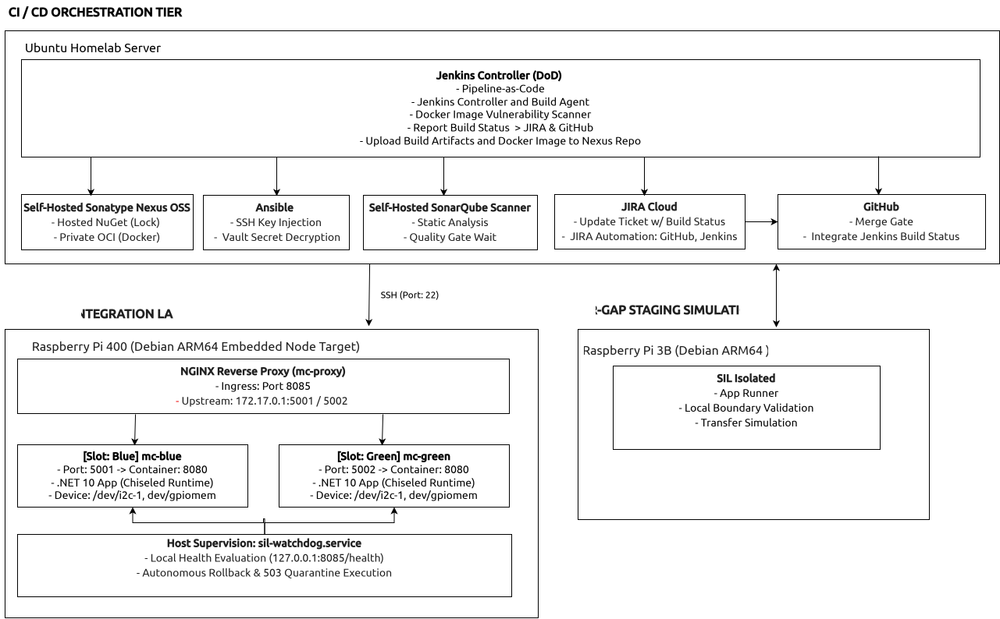
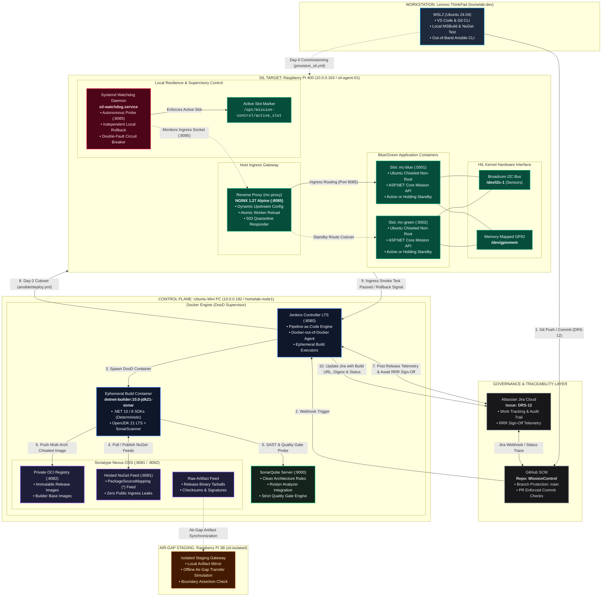
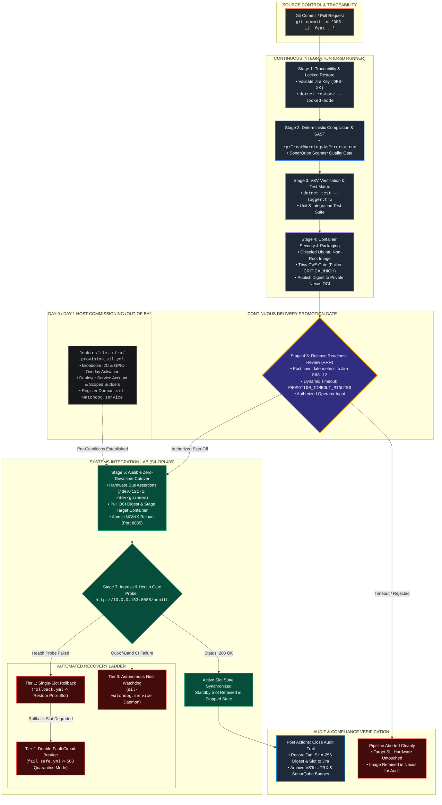
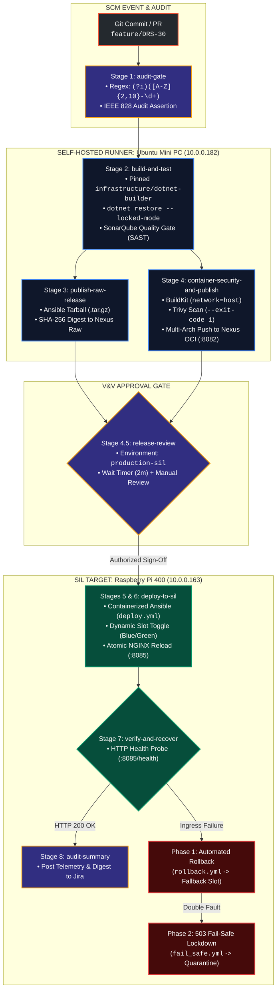

# MissionControl: Defence-Grade CI/CD & SIL Deployment Pipeline for C# / .NET

[%20%7C%20IEEE%20828-0052cc?style=flat-square&logo=shield)](docs/cgp-compliance-matrix.md)
[](https://opstime.atlassian.net/browse/DRS-12)
[](#7-devsecops--supply-chain-governance)
[](#5-cicd-delivery-pipeline-architecture-jenkinsfile)
[](#7-devsecops--supply-chain-governance)
[%20%7C%20I2C%20%2B%20GPIO-C51A4A?style=flat-square&logo=raspberrypi)](#3-hardware-in-the-loop-hil-testbed-topology)
[](#8-bluegreen-zero-downtime-deployment-engine)
[](#5-cicd-delivery-pipeline-architecture-jenkinsfile)
[](https://github.com/opstime-labs/mission-control/actions/workflows/mission-control-ci-cd.yml)
An enterprise-grade, auditable CI/CD delivery pipeline and deployment framework engineered for mission-critical C#/.NET naval sensor, combat management, and Electronic Warfare (EW) edge gateways. Purpose-built to satisfy the rigorous audit, configuration control (IEEE 828 / EIA-649), and security mandates of Canadian defence Systems Integration Laboratories (SIL) and tactical edge nodes, this framework demonstrates bit-for-bit reproducible builds, air-gapped supply chain governance, distroless runtime hardening, Hardware-in-the-Loop pre-flight assertions, and autonomous fault recovery.

---

## 1. Executive Summary & Architecture Highlights

* **Reproducible .NET SDK Compilation:** Solution-wide deterministic compilation (`/p:Deterministic=true`), compiler warning zero-tolerance (`/p:TreatWarningsAsErrors=true`), SourceLink Git commit embedding (`/p:ContinuousIntegrationBuild=true`), and strict SHA-512 dependency locking via `packages.lock.json` with `dotnet restore --locked-mode`.
* **Air-Gapped Supply Chain Governance:** Self-hosted Sonatype Nexus OSS hosting authenticated private OCI Docker registries, raw release binary artifacts (`dotnet publish -c Release`) and local NuGet feeds with strict `<packageSourceMapping>` active. Eliminates external public package tampering and prevents runtime dependency leakage to public feeds like `nuget.org`.
* **Immutable Custom Build Runner Image:** Pre-baked, audited build agent image (`infrastructure/dotnet-builder`) bundling modern .NET SDKs, OpenJDK 21 LTS headless, and pinned `dotnet-sonarscanner` CLI in universal system paths (`/usr/local/bin`). Eliminates out-of-band runtime package manager calls (`apt-get`) and internet downloads on build executors.
* **Hardened Distroless Packaging:** Multi-stage Docker builds targeting **Ubuntu Chiseled** (`mcr.microsoft.com/dotnet/aspnet:10.0-noble-chiseled` / `8.0-jammy-chiseled`), executing unprivileged under `$APP_UID`, completely stripped of shells (`/bin/sh`), package managers (`apt`), and root escalation vectors.
* **Automated DevSecOps Quality Gating:** Jenkins Pipeline-as-Code natively enforcing SonarQube quality gates (`sonar.qualitygate.wait=true`) for SAST/Roslyn analysis and Aquasec Trivy vulnerability scanning with hard build-breaking thresholds (`--exit-code 1` on `HIGH`/`CRITICAL` CVEs and secrets).
* **Automated Infrastructure & Deployment via Ansible:** 
  * *Day-0 Host Baselines (`provision_sil.yml`):* Automated systemd daemon configuration, runtime directory layouts, and out-of-band host provisioning.
  * *Day-2 Blue/Green Application Deployment (`deploy.yml`):* Idempotent container lifecycle management, non-root hardware device bindings, dynamic Docker IPAM gateway discovery, and atomic zero-downtime reverse-proxy cutovers.
* **Hardware-in-the-Loop (HIL) Pre-Flight Gating:** Ansible pre-flight assertions evaluating host environmental limits (thermal throttling ceilings, memory headroom, `/opt` partition thresholds) and validating physical Linux kernel character device node availability (`/dev/i2c-1`, `/dev/gpiomem`, `/dev/ttyUSB0`) prior to container staging.
* **Blue/Green Zero-Downtime Deployment Engine:** Atomic reverse-proxy route shifts on unprivileged custom ports (`8085`) utilizing dynamic NGINX upstream template generation and graceful master reloads (`nginx -s reload`), preserving the previous slot in an idle holding state for instantaneous rollback.
* **Multi-Tier Fault Recovery & Autonomous Survival Ladder:**
  1. *Pipeline-Level Automated Rollback:* Immediate fallback to the standby slot upon smoke test degradation (`HTTP 502/504/404`), marking builds as `UNSTABLE` while preserving node operations.
  2. *Double-Fault Critical Stop Protocol (`fail_safe.yml`):* Quarantines target hardware into an isolated `HTTP 503` Maintenance Mode with `Retry-After: 300` headers and automatically extracts kernel logs (`dmesg`), container stdouts, and network sockets if both execution slots fail.
  3. *Autonomous Host Supervisor (`sil-watchdog.service`):* Embedded host-level systemd daemon continuously monitoring ingress sockets out-of-band, executing local rollbacks or quarantine freezes if central CI network connectivity is lost.
* **Configuration Audit & Traceability Gate:** 
  * Strict Git commit message format enforcement requiring valid Jira issue keys (e.g., `DRS-12: <type>(<scope>): <summary>`).
  * Jenkins pipeline validation verifying that incoming branch names, commit headers, and change sets correlate to verified Jira tracking records before compilation.
* **GitHub Repository Governance & Branch Protection:** 
  * Direct commits to `main` strictly prohibited via branch protection rules.
  * Enforced Peer Review Pull Request workflows requiring branch up-to-date checks, linear commit histories, and mandatory signed commits.
  * Webhook-driven Jenkins commit status integration (`Pending`, `Success`, `Failure`) gating PR merges directly on successful CI test and security passes.
* **Jira Integration & Bidirectional Lifecycle Automation:** 
  * Automated REST API integration updating Jira issue records (`DRS-12`) with console build URLs, commit SHAs, test summary TRX evidence, and OCI image digest coordinates.
  * Webhook and API automation linking GitHub Pull Request lifecycle changes (opened, reviewed, merged) directly into Jira release workflow states.
* **End-to-End Closed-Loop Audit Traceability:** Immutable bidirectional traceability bridging Jira requirements, Git commit SHAs, Jenkins pipeline executions, SonarQube quality gates, Nexus artifact digests, and SIL hardware cutover events—guaranteeing complete verification evidence for defence audits, release readiness reviews (RRR), and Controlled Goods inspections.

---

## 2. System Architecture
<!--
<p align="center">
  
</p>
-->


---

## 3. Hardware-in-the-Loop (HIL) Testbed Topology

| Node Identifier | Hardware & OS | Operational Role | Key Software Components |
| :--- | :--- | :--- | :--- |
| **`homelab-dev`** | Lenovo ThinkPad (WSL2 Ubuntu 24.04) | Workstation & Out-of-Band Admin | Git, VS Code, Ansible Core, SSH |
| **`homelab-node1`** | Mini PC (AMD Ryzen 7, 32GB RAM, Ubuntu) | CI Controller & Registry Store | Jenkins (DooD), Sonatype Nexus OSS, Docker Engine |
| **`sil-agent-01`** | Raspberry Pi 400 (4GB RAM, Broadcom ARM64) | SIL Edge Integration Target | Docker Engine, NGINX 1.27, Broadcom I2C bus |
| **`sil-isolated`** | Raspberry Pi 3B (1GB RAM, Debian) | Air-Gap Staging Simulation | Local boundary validation, transfer simulation |

---

## 4. Tech Stack & Tooling Architecture

| Architectural Tier | Technology / Tooling | Version / Specification | Defence & SIL Role / Justification |
| :--- | :--- | :--- | :--- |
| **Language & SDK Runtime** | **C# / .NET SDK** | `net10.0` / `net8.0` (LTS) | Mission gateway microservices, ASP.NET Core Kestrel web host, P/Invoke native interop bindings. |
| **Build Engine & Compilation** | **MSBuild & .NET CLI** | Integrated SDK 10 / 8 | Deterministic compilation (`/p:Deterministic=true`), zero-compiler-warning policy (`/p:TreatWarningsAsErrors=true`), SourceLink Git metadata. |
| **Dependency Governance** | **NuGet Package Manager** | `packages.lock.json` + `nuget.config` | Strict SHA-512 dependency hashing via `--locked-mode`; air-gapped `<packageSourceMapping>` strictly preventing public registry lookups. |
| **Container Runtime & Base** | **Docker Engine & Buildx** | MCR Ubuntu Jammy/Noble Chiseled | Distroless, hardened non-root container images (`$APP_UID`), devoid of shells, package managers, and standard attack vectors. |
| **Pipeline-as-Code (CI/CD)** | **Jenkins (DooD)** | 2.541+ LTS (Declarative `Jenkinsfile`) | 7-stage multibranch pipeline: locked build, SAST, CVE scan, OCI push, Ansible deployment, automated smoke test, and rollback triggers. |
| **Artifact & Registry Hub** | **Sonatype Nexus OSS** | 3.7x (Private Hosted/Group) | Private authenticated OCI Docker v2 registry (`:8082`), internal NuGet feed (`:8081`), and raw binary tarball storage. |
| **Static Code Analysis (SAST)** | **SonarQube Community** | 10.x Server / Scanner 9.0.1 | Quality gate enforcement (`sonar.qualitygate.wait=true`), Roslyn code analysis rules, and automated test coverage reporting. |
| **Container CVE & Secret Scan** | **Aquasec Trivy** | v0.58+ | Automated vulnerability gate scanning candidate images for `HIGH` and `CRITICAL` CVEs before registry ingress. |
| **Deployment Orchestration** | **Ansible Core** | 2.16+ (`community.docker`, `ansible.posix`) | Idempotent SIL cutover, Hardware-in-the-Loop pre-flight assertions, dynamic Docker IPAM gateway discovery, zero-downtime execution. |
| **Secrets Management** | **Ansible Vault** | AES-256 (`vault.yml`) | Encryption-at-rest for registry tokens and private deployment keys; transient memory decryption eliminating process-table exposure (`ps aux`). |
| **Edge Ingress & Reverse Proxy**| **NGINX Reverse Proxy** | 1.27 Alpine | Atomic upstream proxy cutover on unprivileged port `8085`, graceful worker reload (`nginx -s reload`), and 503 maintenance mode quarantine. |
| **Embedded Supervisor / Watchdog**| **Systemd & Bash** | `sil-watchdog.service` | Out-of-band host supervisor daemon monitoring port 8085, executing autonomous rollback and double-fault quarantine when CI is unreachable. |
| **Hardware Bus (HIL)** | **Linux Kernel Device Tree** | Broadcom I2C (`/dev/i2c-1`), `/dev/gpiomem` | Hardware-in-the-Loop character device node validation and non-root POSIX container passthrough for sensor subsystems. |
| **Audit & Issue Traceability** | **Atlassian Jira REST API** | v2 REST API (Issue `DRS-12`) | Automated bidirectional telemetry logging commit SHAs, test results, build outcomes, and forensic quarantine dumps to release tickets. |
---
## 5. CI/CD Delivery Pipeline Architecture (`Jenkinsfile`)

The delivery pipeline enforces IEEE 828 configuration baselines and Controlled Goods data integrity across seven deterministic, containerized stages:



### Pipeline Stage & Verification Matrix

| Stage | Focus Area | Technical Mechanism | Exit Gate / Compliance Rule |
| :--- | :--- | :--- | :--- |
| **1. Traceability & Dependency Lock** | Supply Chain Security | Git log regex parsing + `dotnet restore --locked-mode` | Rejects commits lacking Jira ticket IDs; aborts on dependency drift (`NU1004`). |
| **2. Compilation & SAST** | Code Quality & Hardening | `dotnet build /p:TreatWarningsAsErrors=true` + SonarQube | Zero compiler warnings tolerated; SonarQube Quality Gate must pass `OK`. |
| **3. Test & TRX Evidence** | V&V Verification | `dotnet test --logger "trx;LogFileName=..."` | 100% pass rate required; archives machine-readable TRX evidence for audit. |
| **4. Packaging & CVE Scan** | Attack Surface Reduction | Docker multi-stage (Ubuntu Chiseled) + Trivy Scanner | Blocks push if unpatched CRITICAL CVEs exist; pushes signed digests to Nexus. |
| **4.5. Release Readiness (RRR)** | Continuous Delivery | Jira API REST notification + Jenkins `input` step | Requires authorized human approval within `PROMOTION_TIMEOUT_MINUTES`. |
| **5. SIL Hardware Cutover** | Zero-Downtime Blue/Green | Ansible playbook (`deploy.yml`) + NGINX reload | Asserts `/dev/i2c-1` presence; atomic upstream reload on port `8085`. |
| **7. Ingress Verification** | Autonomous Resilience | HTTP polling + automated recovery ladder | Reverts to holding slot on failure; locks into 503 quarantine if double-faulted. |
| **Post Actions** | Regulatory Traceability | Jira Cloud REST API + workspace cleanup | Synchronizes release tag and artifact digests back to Jira ticket (`DRS-12`). |

---

## 5.1. Dual-Engine Orchestration: Jenkins & GitHub Actions Parity

To demonstrate enterprise infrastructure flexibility across both legacy on-premises installations and modern enterprise SCM platforms, MissionControl provides **bit-for-bit pipeline parity** across two distinct orchestrators:
1. **Jenkins Declarative Pipeline (`Jenkinsfile`):** Docker-out-of-Docker (DooD) controller model running on the Ubuntu Mini PC.
2. **GitHub Actions Enterprise Workflow (`.github/workflows/mission-control-ci-cd.yml`):** Executing on a hardened, self-hosted Linux runner inside the private subnet without public ingress exposure.


---
## 6. Immutable Custom Build Runner Infrastructure

In air-gapped defence environments, running dynamic package downloads (`apt-get update`, `dotnet tool install`) during every CI/CD run introduces supply-chain vulnerabilities, slows build throughput, and violates Configuration Management baselines. 

To eliminate out-of-band external dependencies, the pipeline uses a custom, pre-baked, immutable build runner image (`infrastructure/dotnet-builder`) stored directly in our private Sonatype Nexus registry.

### Build Runner Specification (`infra/builder/Dockerfile`)

```dockerfile
# Pinned OS distribution base: Ubuntu Noble (24.04 LTS) for glibc stability
FROM mcr.microsoft.com/dotnet/sdk:10.0-noble

ENV DEBIAN_FRONTEND=noninteractive \
    DOTNET_CLI_TELEMETRY_OPTOUT=1 \
    JAVA_HOME=/usr/lib/jvm/java-21-openjdk-amd64 \
    PATH="/usr/local/bin:${PATH}"

# Pre-install Java 21 LTS headless runtime required by SonarScanner CLI
RUN apt-get update -qq \
    && apt-get install -y --no-install-recommends openjdk-21-jre-headless \
    && apt-get clean \
    && rm -rf /var/lib/apt/lists/*

# Install pinned dotnet-sonarscanner into the global system binary path (/usr/local/bin)
# Ensures availability across arbitrary user IDs and non-login shell execution contexts
RUN dotnet tool install --tool-path /usr/local/bin dotnet-sonarscanner --version 9.0.1 \
    && chmod +x /usr/local/bin/dotnet-sonarscanner
```

### Build & Publication Workflow
```bash
# Build and tag with explicit immutable versioning:
docker build -t nexus.homelab.local:8082/infrastructure/dotnet-builder:10.0-jdk21-sonar9.0.1-r1 docker/build-agent/

# Verify tool availability:
docker run --rm nexus.homelab.local:8082/infrastructure/dotnet-builder:10.0-jdk21-sonar9.0.1-r1 dotnet-sonarscanner --version

# Publish to private Nexus OCI registry:
docker push nexus.homelab.local:8082/infrastructure/dotnet-builder:10.0-jdk21-sonar9.0.1-r1
```

---

## 7. DevSecOps, Supply Chain Governance & Threat Model

In compliance with Canadian Controlled Goods Program (CGP) regulations, NATO air-gap guidelines, and IEEE 828 configuration baselines, security is engineered directly into the build and delivery lifecycle rather than applied as a post-build audit.
### The Architecture & Threat Matrix
| Security Tier | Threat Vector Mitigated | Technical Enforcement Mechanism | Compliance / Defence Impact |
| :--- | :--- | :--- | :--- |
| **Supply Chain & Feeds** | Dependency confusion, package poisoning, public feed tampering | `<packageSourceMapping>` in `nuget.config` routing `*` strictly to authenticated Nexus hosted repo (`:8081`). | Eliminates internet dependency leakage and untracked code injection in air-gapped environments. |
| **Dependency Integrity** | Transitive drift, unvetted minor updates | `packages.lock.json` + `dotnet restore --locked-mode` in `Directory.Build.props` (fails on `NU1004`). | Guarantees bit-for-bit cryptographic SHA-512 package reproducibility across all runners. |
| **Static Code Analysis** | Code smells, unhandled async faults, insecure patterns | Roslyn analyzers + `dotnet-sonarscanner` with synchronous gating (`sonar.qualitygate.wait=true`). | Enforces zero compiler warnings (`/p:TreatWarningsAsErrors=true`) and automated quality gate halts. |
| **Container Hardening** | Shell escape, lateral movement, root escalation | Ubuntu Chiseled base (`aspnet:10.0-noble-chiseled`) executing under unprivileged `$APP_UID`. | Distroless attack surface reduction: zero shells (`/bin/sh`), zero package managers (`apt`). |
| **Vulnerability Gating** | Known CVEs and hardcoded secrets | Aquasec Trivy scanning container layers with `--exit-code 1 --severity HIGH,CRITICAL`. | Hard build-breaking gate blocking vulnerable artifacts from entering private OCI registries. |
| **Credential Protection** | Process table snooping (`ps aux`, `/proc/<pid>/cmdline`) | AES-256 Ansible Vault (`vault.yml`) + ephemeral configuration buffers securely shredded (`shred -u -z`). | Prevents credential leakage across multi-tenant runner kernels and transient memory dumps. |
| **Delivery Authorization** | Uncoordinated target modification | Stage 4.5 Release Readiness Review (RRR) gate with bounded timeout (`PROMOTION_TIMEOUT_MINUTES`). | Prevents automated CI merges from clobbering active V&V / SIL hardware test sequences. |

### 7.1. Solution-Wide Deterministic Configuration (`Directory.Build.props`)
```xml
<Project>
  <PropertyGroup>
    <TargetFramework>net10.0</TargetFramework>
    <LangVersion>latest</LangVersion>
    <Nullable>enable</Nullable>
    <ImplicitUsings>enable</ImplicitUsings>

    <!-- Controlled Goods Baseline: Zero Compiler Warning Tolerance -->
    <TreatWarningsAsErrors>true</TreatWarningsAsErrors>

    <!-- SAST & Roslyn Code Analysis -->
    <EnableNETAnalyzers>true</EnableNETAnalyzers>
    <AnalysisLevel>latest-all</AnalysisLevel>
    <AnalysisMode>AllEnabledByDefault</AnalysisMode>
    <EnforceCodeStyleInBuild>true</EnforceCodeStyleInBuild>

    <!-- Supply Chain Security Audit (NuGet SCA) -->
    <NuGetAudit>true</NuGetAudit>
    <NuGetAuditMode>all</NuGetAuditMode>
    <NuGetAuditLevel>low</NuGetAuditLevel>
    <WarningsAsErrors>$(WarningsAsErrors);NU1901;NU1902;NU1903;NU1904</WarningsAsErrors>
    <NoWarn>$(NoWarn);NU1803</NoWarn>

    <!-- Immutability & Deterministic Restores -->
    <RestorePackagesWithLockFile>true</RestorePackagesWithLockFile>
    <RestoreLockedMode Condition="'$(ContinuousIntegrationBuild)' == 'true' Or '$(CI)' == 'true'">true</RestoreLockedMode>
    <Deterministic>true</Deterministic>
    <ContinuousIntegrationBuild Condition="'$(ContinuousIntegrationBuild)' == 'true' Or '$(CI)' == 'true'">true</ContinuousIntegrationBuild>

    <!-- Embedded Debug Symbols for Linux Core Dump Triage -->
    <DebugType>embedded</DebugType>
    <DebugSymbols>true</DebugSymbols>
    <AutoGenerateBindingRedirects>false</AutoGenerateBindingRedirects>
  </PropertyGroup>
</Project>
```

### 7.2. Air-Gapped Package Source Mapping (`nuget.config`)
```xml
<?xml version="1.0" encoding="utf-8"?>
<configuration>
  <packageSources>
    <clear />
    <add key="nexus-hosted-nuget" 
         value="http://10.0.0.182:8081/repository/nuget-group/index.json" 
         allowInsecureConnections="true" />
  </packageSources>

  <packageSourceMapping>
    <packageSource key="nexus-hosted-nuget">
      <package pattern="*" />
    </packageSourceMapping>
  </packageSourceMapping>
</configuration>
```

### 7.3. Hardened Distroless Packaging (`Dockerfile`)
```dockerfile
# Stage 1: Build & Publish via .NET SDK
FROM mcr.microsoft.com/dotnet/sdk:10.0-noble AS build
WORKDIR /src

COPY Directory.Build.props nuget.config ./
COPY src/MissionControl.Api/MissionControl.Api.csproj src/MissionControl.Api/
COPY src/MissionControl.Api/packages.lock.json src/MissionControl.Api/

RUN dotnet restore src/MissionControl.Api/MissionControl.Api.csproj \
    --configfile nuget.config \
    --locked-mode

COPY src/MissionControl.Api/ src/MissionControl.Api/
WORKDIR /src/src/MissionControl.Api
RUN dotnet publish MissionControl.Api.csproj \
    -c Release \
    --no-restore \
    -o /app/publish \
    /p:ContinuousIntegrationBuild=true \
    /p:UseAppHost=false

# Stage 2: Distroless Hardened Runtime (Ubuntu Chiseled)
FROM mcr.microsoft.com/dotnet/aspnet:10.0-noble-chiseled AS final
WORKDIR /app

USER $APP_UID

COPY --from=build --chown=$APP_UID:$APP_UID /app/publish .

ENV ASPNETCORE_HTTP_PORTS=8080 \
    DOTNET_EnableDiagnostics=0 \
    DOTNET_CLI_TELEMETRY_OPTOUT=1

EXPOSE 8080
ENTRYPOINT ["dotnet", "MissionControl.Api.dll"]
```


---

## 8. Blue/Green Zero-Downtime Deployment Engine

### Dynamic Slot Topology Calculation (`ansible/roles/blue_green/tasks/main.yml`)
```yaml
# ==============================================================================
# PHASE 1: DISCOVERY & QUARANTINE RECOVERY
# ==============================================================================
- name: Read current active deployment slot from baseline file
  ansible.builtin.slurp:
    src: "{{ app_base_dir }}/active_slot"
  register: active_slot_raw

- name: Normalize active slot state and detect quarantine
  ansible.builtin.set_fact:
    raw_slot: "{{ active_slot_raw.content | b64decode | trim }}"

- name: Evaluate deployment recovery posture
  ansible.builtin.set_fact:
    is_quarantined: "{{ raw_slot not in ['blue', 'green'] }}"
    current_slot: "{{ 'none' if (raw_slot not in ['blue', 'green']) else raw_slot }}"
    target_slot: "{{ 'blue' if (raw_slot not in ['blue', 'green']) else ('green' if raw_slot == 'blue' else 'blue') }}"

- name: Set dynamic slot port mappings safely
  ansible.builtin.set_fact:
    current_port: "{{ slots[current_slot].port if not is_quarantined else 0 }}"
    target_port: "{{ slots[target_slot].port }}"

- name: Inspect Docker bridge network to dynamically resolve Gateway IP
  community.docker.docker_network_info:
    name: bridge
  register: docker_bridge_info

- name: Assign dynamic Docker gateway IP
  ansible.builtin.set_fact:
    docker_gw_ip: "{{ docker_bridge_info.network.IPAM.Config[0].Gateway }}"
```

### Ingress Upstream Template (`gateway.conf.j2`)
```nginx
upstream mission_control_backend {
    server {{ docker_gw_ip }}:{{ target_port }} max_fails=3 fail_timeout=5s;
    keepalive 32;
}

server {
    listen {{ ingress_port }} default_server;
    server_name _;

    proxy_connect_timeout 2s;
    proxy_read_timeout 5s;
    proxy_send_timeout 2s;

    location /health {
        proxy_pass http://mission_control_backend;
        proxy_http_version 1.1;
        proxy_set_header Connection "";
        proxy_set_header Host $host;
        access_log off;
    }

    location / {
        proxy_pass http://mission_control_backend;
        proxy_http_version 1.1;
        proxy_set_header Connection "";
        proxy_set_header Host $host;
        proxy_set_header X-Real-IP $remote_addr;
        proxy_set_header X-Forwarded-For $proxy_add_x_forwarded_for;
    }
}
```

---

## 9. Hardware-in-the-Loop (HIL) Pre-Flight Gating

```yaml
# ==============================================================================
# PHASE 0: HARDWARE-IN-THE-LOOP (HIL) SENSOR & HOST PRE-FLIGHT DIAGNOSTICS
# ==============================================================================
- name: Probe required hardware bus device nodes
  ansible.builtin.stat:
    path: "{{ item }}"
  loop:
    - "/dev/i2c-1"
    - "/dev/gpiomem"
  register: hil_devices_probe

- name: Gate deployment on physical device node availability
  ansible.builtin.assert:
    that:
      - item.stat.exists
    fail_msg: "CRITICAL HIL FAILURE: Hardware device [{{ item.item }}] is not bound on the target node."
    success_msg: "Hardware device [{{ item.item }}] present and bound."
  loop: "{{ hil_devices_probe.results }}"
  loop_control:
    label: "{{ item.item }}"

- name: Inspect target node disk capacity on deployment partition (/opt)
  ansible.builtin.shell: "df --output=avail -k /opt | tail -n 1"
  register: opt_avail_kb
  changed_when: false
  become: no

- name: Gate deployment if target filesystem free space is below threshold (< 1GB)
  ansible.builtin.assert:
    that:
      - (opt_avail_kb.stdout | trim | int) >= 1048576
    fail_msg: "CRITICAL: Target node /opt partition has less than 1GB free (Available: {{ opt_avail_kb.stdout | trim }} KB)."
    success_msg: "Disk capacity verified: {{ (opt_avail_kb.stdout | trim | int / 1024) | round(2) }} MB available on /opt."

- name: Probe CPU thermal envelope on target embedded hardware (Broadcom/ARM/x86)
  ansible.builtin.shell: |
    if [ -f /sys/class/thermal/thermal_zone0/temp ]; then
      cat /sys/class/thermal/thermal_zone0/temp
    elif command -v vcgencmd >/dev/null 2>&1; then
      vcgencmd measure_temp | grep -o -E '[0-9.]+' | awk '{print $1 * 1000}'
    else
      echo "45000"
    fi
  register: host_temp_raw
  changed_when: false
  become: no

- name: Gate deployment if node thermal limit is exceeded (> 75°C)
  ansible.builtin.assert:
    that:
      - (host_temp_raw.stdout | trim | int) <= 75000
    fail_msg: "CRITICAL: Thermal throttling danger! Node temperature is {{ (host_temp_raw.stdout | trim | int / 1000) | round(1) }}°C. Threshold is 75°C."
    success_msg: "Thermal envelope nominal: {{ (host_temp_raw.stdout | trim | int / 1000) | round(1) }}°C."
```

---

## 10. Autonomous Fail-Safe & Watchdog Engine

### Autonomous Node Watchdog (`/opt/mission-control/bin/sil-watchdog.sh`)
```bash
#!/usr/bin/env bash
set -euo pipefail

APP_BASE="/opt/mission-control"
ACTIVE_SLOT_FILE="${APP_BASE}/active_slot"
NGINX_CONF="${APP_BASE}/nginx/conf.d/gateway.conf"
PROBE_URL="http://127.0.0.1:8085/health"
MAX_FAILURES=3
CHECK_INTERVAL_SEC=5
TRIAGE_DIR="${APP_BASE}/triage"

PORT_blue=5001
PORT_green=5002

log() {
    echo "[$(date -u +'%Y-%m-%dT%H:%M:%SZ')] [WATCHDOG] $*"
}

engage_critical_stop() {
    local incident_dir="${TRIAGE_DIR}/watchdog-doublefault-$(date +%s)"
    log "CRITICAL: Fallback slot failed readiness! Engaging forensic fail-safe lockdown..."
    mkdir -p "${incident_dir}"

    docker logs --tail 200 mc-blue > "${incident_dir}/mc-blue.log" 2>&1 || true
    docker logs --tail 200 mc-green > "${incident_dir}/mc-green.log" 2>&1 || true
    docker logs --tail 200 mc-proxy > "${incident_dir}/mc-proxy.log" 2>&1 || true
    dmesg -T | tail -n 150 > "${incident_dir}/dmesg.log" 2>&1 || true
    ss -tlpn > "${incident_dir}/sockets.log" 2>&1 || true

    cat << 'NGINX_FAIL' > "${NGINX_CONF}"
server {
    listen 8085 default_server;
    server_name _;

    location / {
        default_type application/json;
        add_header Retry-After 300 always;
        return 503 '{"status":"CRITICAL_STOP","error":"SIL Node Quarantined by Local Watchdog. Both application slots degraded."}\n';
    }

    location /health {
        default_type text/plain;
        return 503 'Maintenance Mode - Watchdog Quarantined\n';
    }
}
NGINX_FAIL

    docker exec mc-proxy nginx -s reload || true
    docker stop mc-blue mc-green 2>/dev/null || true
    echo "quarantined_double_fault" > "${ACTIVE_SLOT_FILE}"
    exit 2
}

trigger_local_rollback() {
    local failed_slot="$1"
    local fallback_slot="green"
    local fallback_port=${PORT_green}

    if [[ "${failed_slot}" == "green" ]]; then
        fallback_slot="blue"
        fallback_port=${PORT_blue}
    fi

    log "ALERT: Slot [${failed_slot}] degraded. Initiating autonomous rollback to [${fallback_slot}]..."

    docker start "mc-${fallback_slot}" || engage_critical_stop

    local ready=0
    for attempt in {1..10}; do
        if curl -s -f --connect-timeout 2 --max-time 3 "http://127.0.0.1:${fallback_port}/health" >/dev/null 2>&1; then
            ready=1
            break
        fi
        sleep 1
    done

    if [[ ${ready} -ne 1 ]]; then
        log "ERROR: Standby container mc-${fallback_slot} failed internal readiness probe on port ${fallback_port}."
        engage_critical_stop
    fi

    local docker_gw
    docker_gw=$(docker network inspect bridge --format '{{(index .IPAM.Config 0).Gateway}}')

    cat << NGINX_CONF_OUT > "${NGINX_CONF}"
upstream mission_control_backend {
    server ${docker_gw}:${fallback_port} max_fails=3 fail_timeout=5s;
    keepalive 32;
}

server {
    listen 8085 default_server;
    server_name _;

    proxy_connect_timeout 2s;
    proxy_read_timeout 5s;
    proxy_send_timeout 2s;

    location /health {
        proxy_pass http://mission_control_backend;
        proxy_http_version 1.1;
        proxy_set_header Connection "";
        proxy_set_header Host \$host;
        access_log off;
    }

    location / {
        proxy_pass http://mission_control_backend;
        proxy_http_version 1.1;
        proxy_set_header Connection "";
        proxy_set_header Host \$host;
        proxy_set_header X-Real-IP \$remote_addr;
        proxy_set_header X-Forwarded-For \$proxy_add_x_forwarded_for;
    }
}
NGINX_CONF_OUT

    docker exec mc-proxy nginx -t
    docker exec mc-proxy nginx -s reload

    echo "${fallback_slot}" > "${ACTIVE_SLOT_FILE}"
    docker stop "mc-${failed_slot}" 2>/dev/null || true
    log "SUCCESS: Autonomous rollback completed. Slot [${fallback_slot}] is now active."
}

consecutive_failures=0
log "Watchdog supervisor active on target node. Monitoring ${PROBE_URL} every ${CHECK_INTERVAL_SEC}s..."

while true; do
    if [[ ! -f "${ACTIVE_SLOT_FILE}" ]]; then
        sleep "${CHECK_INTERVAL_SEC}"
        continue
    fi

    active_slot=$(cat "${ACTIVE_SLOT_FILE}" | tr -d '[:space:]')

    if [[ "${active_slot}" == "quarantined_double_fault" ]]; then
        sleep "${CHECK_INTERVAL_SEC}"
        continue
    fi

    if curl -s -f --connect-timeout 2 --max-time 4 "${PROBE_URL}" > /dev/null 2>&1; then
        consecutive_failures=0
    else
        consecutive_failures=$((consecutive_failures + 1))
        log "WARNING: Probe failed (${consecutive_failures}/${MAX_FAILURES}) for slot [${active_slot}]."

        if [[ ${consecutive_failures} -ge ${MAX_FAILURES} ]]; then
            log "THRESHOLD EXCEEDED: Health checks failed consecutively."
            trigger_local_rollback "${active_slot}"
            consecutive_failures=0
        fi
    fi

    sleep "${CHECK_INTERVAL_SEC}"
done
```

---

## 11. Configuration Control & Audit Compliance

### 1. Process-Table Secret Masking via Ansible Vault
To prevent secrets from leaking into `/proc/<pid>/cmdline` or `ps aux`, secrets are committed encrypted via AES-256 in `ansible/group_vars/sil_nodes/vault.yml`:

```yaml
vault_nexus_user: !vault |
          $ANSIBLE_VAULT;1.1;AES256
          31363632363737383232386161323832346633653139333939396365316434316134633333393433
vault_nexus_pass: !vault |
          $ANSIBLE_VAULT;1.1;AES256
          62386337633235313838383333363435343564613532653232313364376536343531353264666632
```

Secrets are passed strictly via `--vault-password-file` referencing an ephemeral, user-restricted file (`chmod 600`) trapped for secure shredding:
```bash
shred -u -z -v -n 3 ./vault_pass_tmp
```

### 2. Jira Closed-Loop Audit Integration (`Jenkinsfile`)
```bash
AUTH_B64=$(printf "%s:%s" "${JIRA_USER}" "${JIRA_TOKEN}" | base64 | tr -d '\n')
CURL_CONF=$(mktemp)
chmod 600 "${CURL_CONF}"
echo "header = \"Authorization: Basic ${AUTH_B64}\"" > "${CURL_CONF}"
trap 'rm -f "${CURL_CONF}"' EXIT INT TERM

curl -s -f -X POST \
  -K "${CURL_CONF}" \
  -H "Accept: application/json" \
  -H "Content-Type: application/json" \
  -d "{\"body\": \"BASELINE DEPLOYMENT HALTED: Build [#${BUILD_NUMBER}] failed smoke test. SIL node placed in Fail-Safe Lock.\"}" \
  "${JIRA_API_ENDPOINT}/${JIRA_KEY}/comment"
```


---

## 12. Verification & Validation Runbook

### Clean Automated Pipeline Run
```bash
# Trigger Jenkins pipeline via Webhook or CLI
# Parameters:
#   BUILD_SCAN_TEST_ENABLE  = true
#   RUN_IMAGE_VULN_SCAN     = true
#   TARGET_TAG              = 50-b5b1f1e
```

### Simulating Automated Ingress Rollback
```bash
# 1. Update Jenkinsfile Stage 7 to probe a deliberately failing path:
curl --fail --retry 3 --retry-delay 2 --max-time 5 http://10.0.0.163:8085/healthx

# 2. Pipeline catches error code 22, runs ansible/rollback.yml,
# restores fallback slot, reloads NGINX, and marks build UNSTABLE.
```

### Simulating Double-Fault Node Quarantine
```bash
# 1. Sabotage standby container mc-green on target node:
docker rm -f mc-green && docker run -d --name mc-green alpine sleep 3600

# 2. Terminate active container mc-blue:
docker stop mc-blue

# 3. Watchdog or Pipeline catches double failure, runs fail_safe.yml,
# deploys 503 Maintenance Ingress, and logs dumps to /opt/mission-control/triage/.
```

---
## 13. Systems Integration Lab (SIL) Hardware Troubleshooting & RCA Matrix

During the commissioning and verification of the physical testbed (Lenovo ThinkPad WSL2 workstation, Ubuntu Mini PC CI controller, and Raspberry Pi 400 ARM64 SIL target node), several low-level kernel, networking, and supply-chain anomalies were diagnosed and resolved. The matrix below documents the root cause analysis (RCA) and automated engineering mitigations applied under IEEE 828 configuration control.

| Subsystem / Layer | Observed Anomaly / Symptom | Root Cause Analysis (RCA) | Engineering Remediation | V&V Automated Prevention Gate |
| :--- | :--- | :--- | :--- | :--- |
| **Network / Ingress** | `curl: (28) Connection timed out` on port `80` while container proxy was active. | Stale K3s / Flannel CNI `iptables` rules in the host kernel's `PREROUTING` and `FORWARD` chains were intercepting inbound physical NIC traffic (`wlan0`) before Docker bridge routing. | Executed full host CNI teardown (`flush-cni.sh`), unlinked `cni0`/`flannel.1` interfaces, flushed filter/NAT tables, and migrated ingress proxy to unprivileged high port `8085`. | Ansible role checks port binding availability and verifies default filter policies prior to proxy container launch. |
| **Orchestration / Ansible** | Deployment cutover failed with `Cannot create container when image is not specified!` | Ansible `community.docker.docker_container` with `state: stopped` attempts container creation if the container does not already exist in daemon memory. | Added dynamic pre-flight inspection tasks via `community.docker.docker_container_info` to evaluate container existence prior to invoking state transitions. | Idempotent task execution gated on container state registered facts in `ansible/roles/blue_green/tasks/main.yml`. |
| **Fault Recovery Ladder** | Automated rollback failed with `Errno 111 Connection refused` during health probe. | Application slot container was bound strictly to the Docker bridge gateway (`172.17.0.1:5002`), while the rollback verification task probed localhost (`127.0.0.1:5002`). | Unified container socket bindings to `0.0.0.0:{{ target_port }}:8080` and standardized internal health verification probes across both active and holding slots. | `ansible/rollback.yml` and `deploy.yml` share synchronized group variables for slot port assignments. |
| **State Machine Governance** | Ansible crashed with `dict has no attribute 'quarantined_double_fault'` on post-incident deploy. | When double-fault lockdown engages, `/opt/mission-control/active_slot` is written as `quarantined_double_fault`. Standard blue/green toggle logic attempted to query `slots['quarantined_double_fault']`. | Implemented recovery state detection in Phase 1 of `main.yml`: if active state is not `blue` or `green`, the pipeline enters `QUARANTINE_RECOVERY` mode and forces a clean baseline onto `blue`. | Automated state normalization task in Ansible handling clean-slate recoveries without manual operator intervention. |
| **Hardware Bus (HIL)** | Deployment gated with `CRITICAL HIL FAILURE: Hardware device [/dev/i2c-1] is not bound`. | Broadcom I2C bus controller was disabled in GPU boot firmware (`config.txt`), leaving character device node uninstantiated by `udev`. | Applied dynamic kernel device tree overlay (`sudo dtoverlay i2c1`), loaded `i2c-dev` module, and added non-root group permissions (`usermod -aG i2c deployer`). | Ansible Phase 0 Hardware-in-the-Loop assertions verify device nodes and system thermals before application staging. |
| **Dependency Governance** | Solution compilation failed with `NU1004: The packages lock file is inconsistent`. | Adding new test package references altered the dependency graph while `RestoreLockedMode=true` was active during a CI compilation run. | Disassociated lockfile generation from CI builds. Established strict workflow: local `--force-evaluate` updates with `RestoreLockedMode=false`, followed by git commit and locked CI verification. | Jenkins Stage 2 enforces `--locked-mode` to block unapproved package drift from entering private registries. |
| **Build Agent Runtime** | SAST execution halted with `bash: dotnet-sonarscanner: command not found`. | `dotnet tool install --global` installs tools to `/root/.dotnet/tools`. Jenkins executed the container with `-e HOME=/tmp`, disconnecting the execution `$PATH` from the binary location. | Rebuilt builder image installing tools via `--tool-path /usr/local/bin`, ensuring universal visibility across all user namespaces and custom `$HOME` overrides. | Pinned builder image (`dotnet-builder:10.0-jdk21-sonar9.0.1-r1`) verified via container integration smoke test prior to registry push. |
| **Process-Table Security** | Sensitive registry and Jira tokens potentially visible via `ps aux` and `/proc/<pid>/cmdline`. | Command-line CLI flags (`-e nexus_pass=...` and `curl -u user:token`) leak plaintext arguments to host process tables in multi-tenant environments. | Migrated secrets to AES-256 encrypted Ansible Vault files and ephemeral `curl -K` configuration files securely shredded (`shred -u -z`) upon task completion. | Jenkins credential file bindings passed strictly via `--vault-password-file` and memory buffers, satisfying CGP cyber postures. |
| **CI/CD / GitHub Actions** | BuildKit multi-arch push failed with `dial tcp: lookup nexus.homelab.local: no such host`. | GitHub's `setup-buildx-action` spawns BuildKit inside an isolated container daemon that ignores host `/etc/hosts` and queries public upstream DNS (`64.71.255.204:53`). | Configured `driver-opts: network=host` on `setup-buildx-action`, allowing BuildKit to share the host network stack and resolve private homelab hostnames. | BuildKit configuration validated for air-gapped registry communication without DNS leaks. |
| **CI/CD / GitHub Actions** | Docker push aborted with `http: server gave HTTP response to HTTPS client`. | Docker BuildKit strictly enforces TLS/HTTPS for registry endpoints by default, whereas the homelab Nexus registry serves plain HTTP on `:8082`. | Injected `buildkitd-config-inline` specifying `[registry."nexus.homelab.local:8082"] http = true` and `insecure = true`. | Automated BuildKit daemon configuration committed to pipeline-as-code. |
| **Runtime Security / POSIX** | SonarScanner halted with `Win32Exception (13): Permission denied` during execution. | Global tools installed as `root` in base image lacked execute (`+x`) permissions across other UID namespaces when container was invoked as an unprivileged user. | Enforced recursive world-executable permissions (`chmod -R a+rx /usr/local/bin/.store`) in the runner startup script. | Pre-flight permission assertion in builder container prevents non-root execution failures. |
| **Runner Workspace Hygiene** | `actions/checkout@v4` threw `EACCES: permission denied` attempting to clean repo. | Previous container run under `root` wrote intermediate `/obj/` and `/bin/` files that the unprivileged host runner user (`chand`) could not unlink. | Added pre-exit ownership synchronization (`chown -R $(id -u):$(id -g) /workspace`) at the end of the containerized build stage. | Eliminates workspace contamination across multi-stage pipeline executions. |
---

## 14. CI/CD Control Plane Provisioning (Infrastructure-as-Code)

The core delivery toolchain (Jenkins DooD, Sonatype Nexus OSS, and SonarQube) running on the Mini PC controller is fully containerized and provisioned deterministically via Docker Compose and systemd host units.

* **Repository Data & State Isolation:** Persistent state mapped to isolated NVMe mount paths (`/opt/nexus-data`, `/var/jenkins_home`, `/opt/sonarqube/data`).
* **Daemon Interop:** Jenkins executes via mounted `/var/run/docker.sock` to spin up ephemeral `.NET` compilation runners and Ansible deployment containers without polluting the host OS.
* **Deterministic Deployment Runbook:** For exact compose manifests, reverse-proxy network bindings, and systemd service descriptors, inspect [`docs/infra-provisioning.md`](docs/infra-provisioning.md).

---
## 15. Engineering Standards & Methodologies

* **Configuration Management:** IEEE 828-2012 / EIA-649 Standards for Configuration Baselines.
* **Static Code Analysis:** SonarQube Clean Architecture / Roslyn Code Analysis Rules (`CA1861`, `CA1852`).
* **Container Security:** CIS Docker Benchmark & NIST SP 800-190 Container Security Guidelines.
* **Infrastructure as Code:** Idempotent Ansible Core Collections (`community.docker`, `ansible.posix`).
