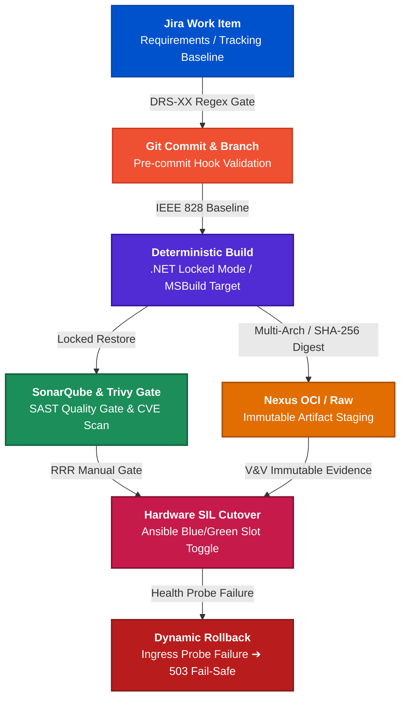

# Controlled Goods Program (CGP) & IEEE 828-2012 Compliance Matrix

**Project:** MissionControl C#/.NET Delivery Framework & Hardware SIL Testbed  
**Target Environment:** Leonardo DRS (Kanata, ON) — Mission Software, Naval Systems & Tactical Edge Gateways  
**Regulatory Frameworks:** 
* Canadian Controlled Goods Regulations (SOR/2001-32 / Defence Production Act)
* IEEE Std 828-2012 (Standard for Configuration Management in Systems and Software Engineering)
* Treasury Board of Canada Secretariat (TBS) Standard on Security Screening (Reliability / Secret)
* ISO/IEC 27001 / NIST SP 800-161 (Cybersecurity Supply Chain Risk Management)

---

## 1. Regulatory Context & Engineering Objectives

In regulated Canadian defence and aerospace contracts, software delivery engines must guarantee absolute non-repudiation, strict supply-chain provenance, air-gapped repeatability, and hardware-in-the-loop auditability. 

The `MissionControl` platform enforces these mandates natively through code across all four orchestrators (**Jenkins**, **GitHub Actions**, **Azure DevOps**, and **GitLab CI**).

---

## 2. Regulatory Compliance Verification Matrix

| Regulation / Standard | Mandatory Requirement | Implementation in `MissionControl` | Verification Artifact & Source Code Reference |
| :--- | :--- | :--- | :--- |
| **CGP (DPA Sec. 38)** | **Exclusion of Unauthorized Technical Data Transfer** Controlled Goods technical data must remain strictly isolated within cleared enclaves. | All CI/CD build actions execute on self-hosted on-premise hardware (Ryzen 7 controller `10.0.0.182`). No proprietary source code, binaries, or telemetry escape to foreign SaaS endpoints. Disables telemetry natively via `DOTNET_CLI_TELEMETRY_OPTOUT=1`. | `azure-pipelines.yml` (lines 62–67) `Jenkinsfile` (lines 53–57) `.gitlab-ci.yml` (`variables: DOTNET_CLI_TELEMETRY_OPTOUT`) |
| **IEEE 828-2012 (Sec. 4.2)** | **Configuration Baseline Identification** Every deployable release candidate must trace directly to an approved requirement and immutable VCS commit. | **Stage 1 Traceability Gate**: Enforces POSIX regex matching for active Jira issue tracking tags (`DRS-[0-9]+`) across branch names and the last 5 commits. Fails compilation immediately if unreferenced. Generates canonical release tag `$(BuildId)-$(ShortSHA)`. | `mission-control-ci-cd.yml` (`jobs.audit-gate`) `Jenkinsfile` (`Stage 1: Configuration Audit`) `azure-pipelines.yml` (`Stage 1: AssertTraceability`) |
| **CGP Sec. 10 / Supply Chain** | **Supply Chain Integrity & Locked Provenance** Prohibits dynamic floating dependency resolution to mitigate poisoned upstream supply chain packages. | Centralized NuGet configuration (`nuget.config`) points to local Sonatype Nexus OSS mirror (`nexus.homelab.local`). Build invocations require `--locked-mode` with bit-for-bit SHA-512 hashes committed in `packages.lock.json`. Zero compiler warnings tolerated (`/p:TreatWarningsAsErrors=true`). | `Directory.Build.props` `nuget.config` `src/MissionControl.Api/packages.lock.json` |
| **NIST SP 800-161 / DevSecOps** | **Static Application Security Testing (SAST)** Enforcement of automated code quality and vulnerability screening before packaging. | Embedded SonarQube SAST gate halts execution (`/d:sonar.qualitygate.wait=true`) on new blocker bugs, security hotspots, or failed unit test assertions reported via VSTest TRX logs. | `Jenkinsfile` (lines 142–153) `azure-pipelines.yml` (`DotNetBuildAndSonar`) |
| **CGP Technical Safeguard** | **Minimal Attack Surface Containerization** Binaries destined for target hardware or edge gateways must eliminate unnecessary utilities (shells, package managers). | Multi-stage Docker build producing an unprivileged, distroless **Ubuntu Chiseled runtime** (`mcr.microsoft.com/dotnet/nightly/aspnet:10.0-chiseled-noble`). Eliminates `sh`, `bash`, `apt`, `curl`. Executes strictly under unprivileged non-root UID `1654`. | `Dockerfile` (stages `build`, `publish`, `runtime`) |
| **IEEE 828-2012 (Sec. 5.1)** | **Release Verification & Validation (V&V)** Vulnerability threshold gating prior to release authorization. | **Aquasec Trivy Container Gate**: Local candidate image is scanned for CVEs with `--exit-code 1 --severity HIGH,CRITICAL`. Build terminates instantly upon detection of unpatched High/Critical CVEs. | `Jenkinsfile` (`Stage 4: Container Security Gate`) `azure-pipelines.yml` (`ContainerTrivyAndPush`) |
| **IEEE 828-2012 (Sec. 4.3)** | **Release Packaging & Binary Immutability** Cryptographic non-repudiation of release binaries delivered to target enclaves. | Framework-dependent binary layouts (`.tar.gz`) are accompanied by runtime-generated cryptographic SHA-256 digests (`.sha256`) pushed to air-gapped Sonatype Nexus raw-hosted repositories. Multi-arch OCI images (`amd64`/`arm64`) pushed to Nexus OCI. | `setup_nexus.sh` `Jenkinsfile` (`Stage 3: Publish Raw Binary Release`) `azure-pipelines.yml` (`PublishRawRelease`) |
| **Defence V&V Mandates** | **Release Readiness Review (RRR) Human Gate** Manual intervention and authorization before cutover to physical naval/command assets. | **Stage 4.5 Release Readiness Review**: Interactive human operator gate with bounded timeout (1 to 480 minutes). Verifies Jira work item, inspects SonarQube/Trivy baselines, and logs authorization reason back into Jira Cloud audit history. | `Jenkinsfile` (`Stage 4.5: Release Readiness Review`) `azure-pipelines.yml` (`production-sil` Environment check) `.gitlab-ci.yml` (`stage_4_5_rrr_gate: when: manual`) |
| **Systems Integration Lab (SIL)** | **Deterministic Hardware Deployment** Target cutovers must execute deterministically without manual human SSH configuration drift. | Ansible automation provisions and cutovers slot configurations on the target SIL hardware node (Raspberry Pi 400 - `10.0.0.163`). Sensitive operational parameters encrypted using Ansible Vault (`vault.yml`). | `ansible/deploy.yml` `ansible/inventory.ini` `ansible/roles/gateway_service/` |
| **Defence Fault Recovery** | **Autonomous Two-Phase Recovery Ladder** Mission systems must fail safely without leaving edge sensors in indeterminate or crashed states. | **Stage 7 Autonomous Recovery**: Post-deployment probe tests ingress readiness on port `8085/health`. If probe fails: * **Phase 1**: Automated rollback to standby previous slot via `ansible/rollback.yml`. * **Phase 2**: If rollback fails, triggers `ansible/fail_safe.yml` locking NGINX to deterministic HTTP 503 maintenance mode. | `Jenkinsfile` (`Stage 7: Ingress Verification`) `azure-pipelines.yml` (`Stage 7: VerifyAndRecover`) `ansible/fail_safe.yml` |

---

## 3. Configuration Management Baseline Ledger (IEEE 828 / EIA-649)

Every artifact generated by the pipeline corresponds to a deterministic baseline state recorded across the traceability ledger:

| Baseline Item | Management Mechanism | Integrity Verification |
| :--- | :--- | :--- |
| **Source Baseline** | Git (`main` branch) | Signed commits, commit SHA-1/SHA-256 pinned |
| **Requirement Baseline** | Jira Cloud API (`DRS-XX`) | Issue status queried & annotated via pipeline cURL |
| **Dependency Baseline** | NuGet Package Lock File | `packages.lock.json` checked into Git, enforced `--locked-mode` |
| **Compilation Baseline** | Centralized MSBuild Settings | `Directory.Build.props` (C# 13, .NET 10/8, WarningsAsErrors=true) |
| **Binary Release Baseline** | Sonatype Nexus Raw Feeds | `mission-control-api-$(TAG).tar.gz` + SHA-256 Checksum file |
| **Container Image Baseline** | Sonatype Nexus OCI Registry | Multi-architecture image manifest (`amd64` / `arm64`) |
| **Target Hardware Baseline** | Raspberry Pi 400 (SIL) | `/opt/mission-control/active_slot` (Blue vs. Green indicator) |

---

