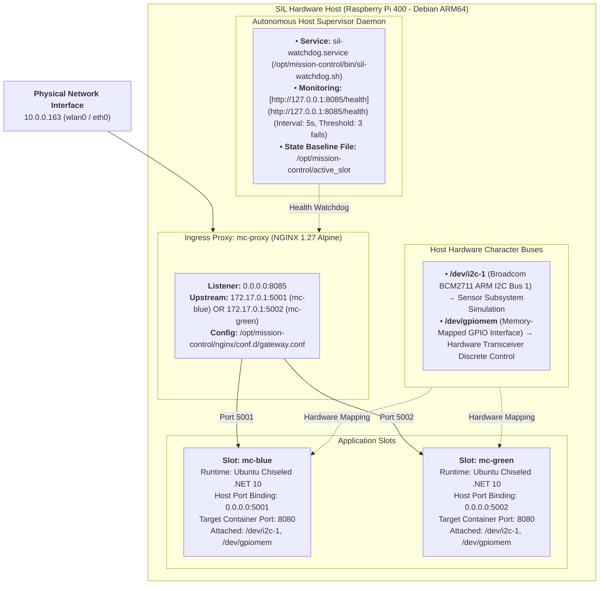
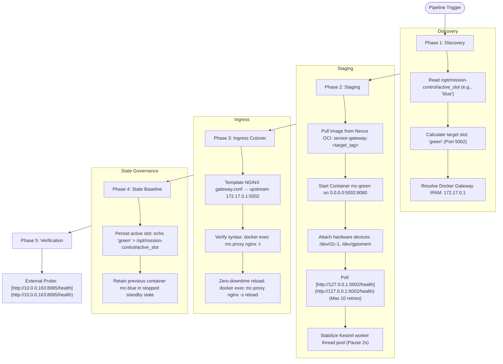
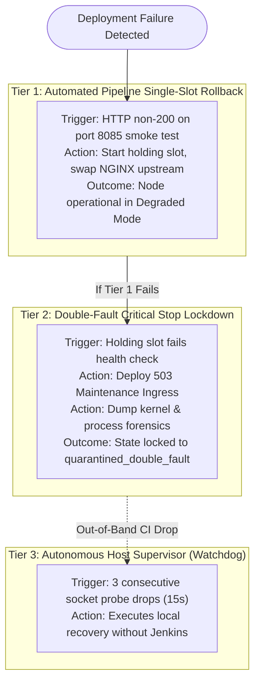

# Systems Integration Laboratory (SIL) Operations & Deployment Runbook
**Target Environment:** Mission-Critical Sensor Gateway & Naval C2 Subsystems  
**Target Hardware Node:** Raspberry Pi 400 (Debian ARM64 | `10.0.0.163` / `sil-target.homelab.local`)  
**Standard Governance:** Controlled Goods Program (CGP), IEEE 828 Configuration Management, EIA-649 Baselines  
**Security Classification:** Controlled Defence Software / Unclassified Staging

---

## 1. Scope & Operational Purpose

This runbook defines the operational procedures for commissioning, deploying, verifying, and recovering the **MissionControl Sensor Gateway API** within a Systems Integration Laboratory (SIL) environment. It establishes reproducible steps for:
* Hardware-in-the-Loop (HIL) character bus verification and thermal gating.
* Blue/Green zero-downtime container slot cutovers over NGINX (Port `8085`).
* Multi-tiered automated rollback and double-fault quarantine recovery ladders.
* Configuration audit verification, evidence extraction, and Jira telemetry synchronization[cite: 10, 11].

---

## 2. SIL Target Node Topology & Port Map


### Port Map Reference
| Service / Component | Host Interface Binding | Protocol / Port | Target Container Port | Purpose / Role |
| :--- | :--- | :--- | :--- | :--- |
| **Ingress Reverse Proxy** | `0.0.0.0` | TCP 8085 | 8085 (`mc-proxy`) | Edge ingress gateway and reverse-proxy. |
| **Application Slot Blue** | `0.0.0.0` | TCP 5001 | 8080 (`mc-blue`) | Candidate or standby execution slot. |
| **Application Slot Green** | `0.0.0.0` | TCP 5002 | 8080 (`mc-green`) | Candidate or standby execution slot. |
| **SSH Management** | `0.0.0.0` | TCP 22 | N/A (Host OpenSSH) | Dedicated deployer orchestration port. |


## 3. Host Commissioning & Day-0 Provisioning
Follow these steps when provisioning a newly imaged embedded hardware node or re-establishing a certified configuration baseline[cite: 10, 11].

### Step 1: Kernel Device Tree Overlay & Driver Activation
Enable the physical Broadcom I2C bus and GPIO memory mapping within the bootloader firmware:

```bash
# 1. Update boot firmware to enable Broadcom I2C
CONFIG_PATH="/boot/firmware/config.txt"
[ ! -f "$CONFIG_PATH" ] && CONFIG_PATH="/boot/config.txt"

sudo sed -i -E 's/^#?dtparam=i2c_arm=.*/dtparam=i2c_arm=on/' "$CONFIG_PATH"
if ! grep -q "^dtparam=i2c_arm=on" "$CONFIG_PATH"; then
    echo "dtparam=i2c_arm=on" | sudo tee -a "$CONFIG_PATH"
fi

# 2. Register i2c-dev driver for persistent boot loading
if ! grep -q "^i2c-dev" /etc/modules; then
    echo "i2c-dev" | sudo tee -a /etc/modules
fi

# 3. Load dynamic device tree overlay live (No reboot required)
sudo dtoverlay i2c1
sudo modprobe i2c-dev

# 4. Verify character device nodes exist
ls -la /dev/i2c-1 /dev/gpiomem
```
### Step 2: User Access & POSIX Security Privileges
Grant the unprivileged deployer account access to Docker and hardware device buses without granting elevated root privileges:

```Bash
sudo usermod -aG docker,i2c,gpio,dialout deployer
```
### Step 3: Run Automated Baseline Provisioning from Workstation
From the development controller (ThinkPad WSL2), invoke the Day-0 configuration playbook:

```Bash
ansible-playbook -i ansible/inventory.ini ansible/provision_sil.yml \
  --private-key ~/.ssh/id_ed25519 \
  -u deployer \
  --ask-become-pass
```
## 4. Hardware-in-the-Loop (HIL) Pre-Flight Diagnostics
Before any software container cutover is executed, the deployment pipeline runs five automated gating assertions.
```bash
# 1. Assert required hardware character device nodes exist
test -e /dev/i2c-1 && test -e /dev/gpiomem && echo "[PASS] HIL character buses verified."

# 2. Check partition capacity (Minimum 1GB free required on /opt)
AVAIL_KB=$(df --output=avail -k /opt | tail -n 1)
if [ "$AVAIL_KB" -lt 1048576 ]; then
    echo "[FAIL] Critical: Less than 1GB storage available on /opt ($AVAIL_KB KB)."
    exit 1
fi

# 3. Check memory headroom (Minimum 256MB free required)
MEM_AVAIL=$(awk '/MemAvailable/ {print $2}' /proc/meminfo)
if [ "$MEM_AVAIL" -lt 262144 ]; then
    echo "[FAIL] Critical: Insufficient memory headroom ($MEM_AVAIL KB)."
    exit 1
fi

# 4. Check processor thermal throttling limits (Max 75°C threshold)
TEMP_RAW=$(cat /sys/class/thermal/thermal_zone0/temp 2>/dev/null || echo "45000")
TEMP_C=$((TEMP_RAW / 1000))
if [ "$TEMP_C" -gt 75 ]; then
    echo "[FAIL] Critical: Target processor thermally throttled at ${TEMP_C}°C. Aborting cutover."
    exit 1
fi
echo "[PASS] Thermal envelope nominal: ${TEMP_C}°C."
```
## 5. Controlled Blue/Green Deployment Workflow
Deployments to the SIL target node are executed via containerized Ansible driven by Jenkins Pipeline-as-Code



## 6. Fault Recovery & Rollback Protocols
The SIL node enforces a 3-tier defense-in-depth recovery ladder


### Tier 1: Single-Slot Rollback Execution
Invoked automatically by Jenkins Stage 7 or executed via CLI:

```Bash
ansible-playbook -i ansible/inventory.ini ansible/rollback.yml \
  --private-key ~/.ssh/id_rsa_deploy \
  --vault-password-file ~/.vault_pass \
  -u deployer
```

#### What it does:

| Step | Action | Technical Detail |
| :---: | :--- | :--- |
| **1** | Query Active Slot | Reads `/opt/mission-control/active_slot` to determine the currently running deployment slot. |
| **2** | Standby Slot Resolution | Computes the standby slot and spins up its container (`mc-blue` or `mc-green`). |
| **3** | Internal Readiness Check | Verifies socket readiness on port `5001` or `5002`. |
| **4** | Ingress Retargeting & Reload | Updates NGINX upstream target in `gateway.conf` and reloads gracefully (`nginx -s reload`). |
| **5** | State Persistence | Overwrites `/opt/mission-control/active_slot` with the restored slot identifier. |
| **6** | Faulted Container Termination | Stops the release candidate container that failed verification. |

### Tier 2: Double-Fault Critical Stop Lockdown (fail_safe.yml)
Invoked when both candidate and fallback slots fail to initialize:

```Bash
ansible-playbook -i ansible/inventory.ini ansible/fail_safe.yml \
  --private-key ~/.ssh/id_rsa_deploy \
  -u deployer    
```
### What it does:
| Step | Action | Technical Detail |
| :---: | :--- | :--- |
| **1** | Incident Directory Creation | Allocates a timestamped triage directory: `/opt/mission-control/triage/double-fault-<epoch>/`. |
| **2** | Forensic Telemetry Extraction | Dumps comprehensive state logs: `mc-blue.log`, `mc-green.log`, `mc-proxy.log`, `dmesg.log`, `listening_sockets.log`, and memory profiles. |
| **3** | Ingress 503 Quarantine | Overwrites NGINX upstream with a static `503 Service Unavailable` maintenance page injecting `Retry-After: 300` headers. |
| **4** | Resource Preservation | Halts all workload containers to prevent CPU and memory resource starvation on the embedded target. |
| **5** | State Lockdown | Writes `quarantined_double_fault` into `/opt/mission-control/active_slot` to block unvetted redeployments. |


## 7. Recovering from a Quarantined State
When a node enters quarantined_double_fault, automated pipelines will halt until an operator performs forensic triage and clears the state.

### Step 1: Inspect Forensic Evidence
```Bash
ssh deployer@10.0.0.163
cd /opt/mission-control/triage
ls -lt | head -n 5

# Inspect the latest failure logs
LATEST_INCIDENT=$(ls -td double-fault-* watchdog-doublefault-* 2>/dev/null | head -n 1)
cd "${LATEST_INCIDENT}"
cat mc-*.log
cat dmesg.log | grep -i -E "oom|segfault|error"
```
### Step 2: Clean Slate Sanitization
Run the automated sanitization script to restore the host network stack and reset the active slot marker:

```Bash
sudo /opt/mission-control/bin/teardown-sil.sh
```

### Step 3: Redeploy Certified Baseline
From your development workstation, trigger a clean deployment targeting the verified release baseline:
```Bash
ansible-playbook -i ansible/inventory.ini ansible/deploy.yml \
  --extra-vars "target_tag=50-b5b1f1e"
```
Verify that the ingress proxy responds with HTTP 200 OK:

```Bash
curl -i [http://10.0.0.163:8085/health](http://10.0.0.163:8085/health)
```

## 8. Node Sanitization & Teardown Script Reference
The standalone sanitization script (/opt/mission-control/bin/teardown-sil.sh) is maintained under configuration control and should be executed whenever preparing the testbed for formal testing:

```Bash
# Execute full teardown and network reset
sudo /opt/mission-control/bin/teardown-sil.sh
```
| Step | Action | Technical Detail |
| :---: | :--- | :--- |
| **1** | Halt Host Services | Stops and disables `sil-watchdog.service`, conflicting web servers (`apache2`, `nginx`, `lighttpd`), and orchestration daemons (`k3s`, `k3s-agent`). |
| **2** | Purge Workload Containers | Force-removes application containers (`mc-proxy`, `mc-blue`, `mc-green`, `mc-test`) and prunes dangling Docker networks and volumes. |
| **3** | Dismantle Virtual Network Bridges | Deletes stale CNI and SDN virtual interfaces (`cni0`, `flannel.1`, `tunl0`, `kube-ipvs0`) and clears IPAM state in `/var/lib/cni/` and `/etc/cni/net.d/`. |
| **4** | Flush Kernel Packet Filters | Resets default `iptables` policies (`INPUT`, `FORWARD`, `OUTPUT` to `ACCEPT`), flushes all rule tables (`nat`, `mangle`, `raw`), and restarts `docker.service` to regenerate pristine bridge routing. |
| **5** | Reset Operational Directory | Archives existing triage logs to `/tmp/`, recreates `/opt/mission-control/` subdirectories (`nginx/conf.d`, `bin`, `triage`), and initializes `/opt/mission-control/active_slot` to `blue`. |
| **6** | Audit Listening Ports | Verifies that unprivileged ingress port `8085` is released and available on the host network stack. |

## 9. Verification & Validation (V&V) Checklist
Execute this checklist prior to formal customer demonstration, release-readiness reviews (RRR), or sea-trial simulation events
- [ ] **Physical Hardware Interfaces:** Confirm `/dev/i2c-1` and `/dev/gpiomem` are bound with permissions `0660` owned by groups `i2c` and `gpio`.
- [ ] **Ingress Routing:** Confirm `curl -s http://10.0.0.163:8085/health` returns `Healthy` with status `200 OK`.
- [ ] **Functional Telemetry:** Confirm `curl -s http://10.0.0.163:8085/weatherforecast` returns valid JSON telemetry containing sensor summaries (`Nominal`, `Active`, `Elevated`).
- [ ] **State Machine Synchronization:** Confirm `/opt/mission-control/active_slot` matches the container receiving traffic in NGINX (`docker exec mc-proxy cat /etc/nginx/conf.d/gateway.conf`).
- [ ] **Standby Slot Readiness:** Confirm the inactive slot container exists in Docker engine memory in a stopped state for instant rollback capability.
- [ ] **Jira Traceability:** Confirm the release tag, commit SHA, and TRX test summary are updated on the tracking issue (e.g., `DRS-12`) via authenticated API.
- [ ] **Kernel Logs:** Confirm `dmesg -T` reports zero Out-of-Memory (OOM) killer invocations or undervoltage throttled flags.